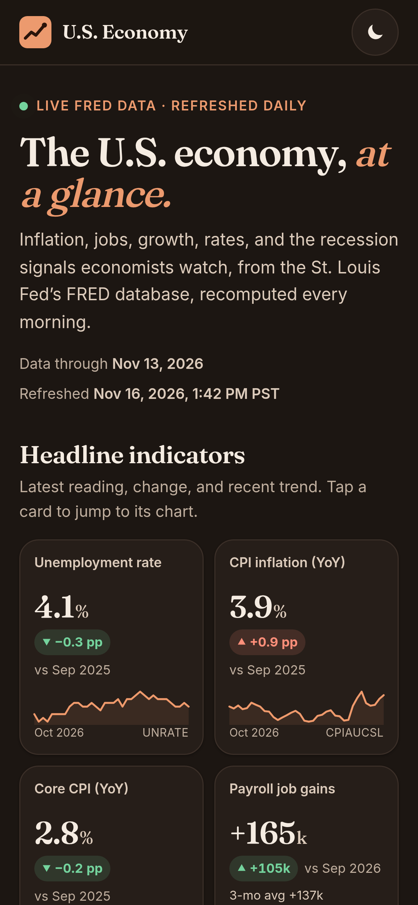
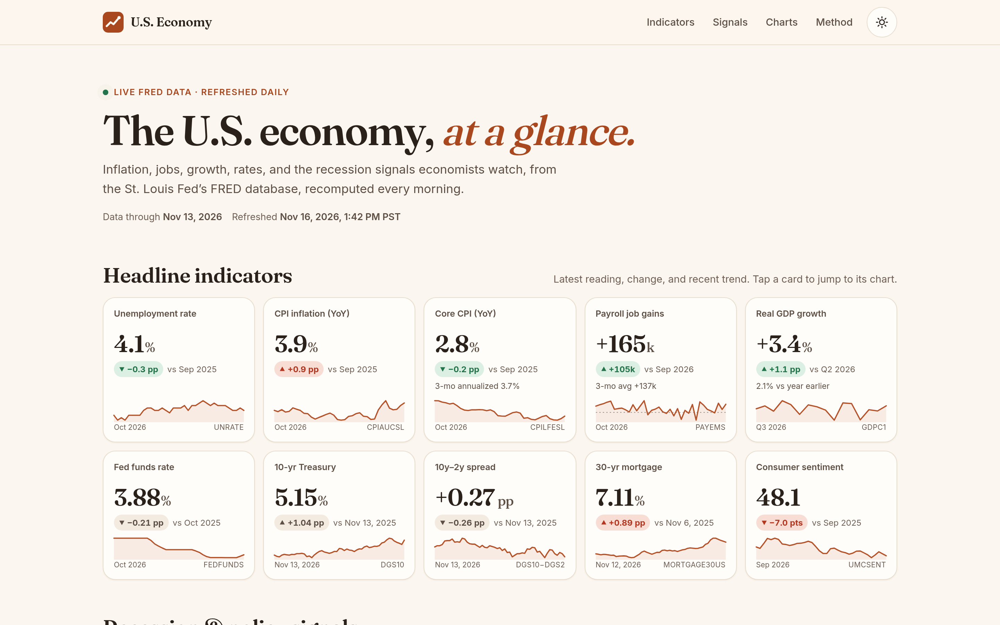
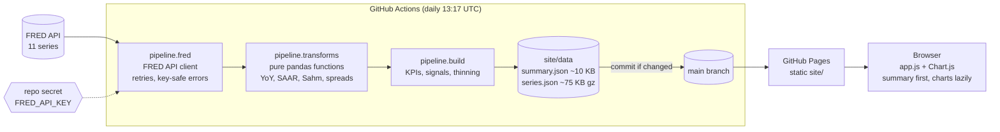

# U.S. Economic Indicators Dashboard

A daily-refreshed, mobile-first dashboard of the U.S. economy built on the St. Louis Fed's **FRED** API: inflation, jobs, growth, interest rates, the yield curve, and consumer sentiment, plus derived recession signals (the **Sahm rule** and **yield-curve inversion** history).

**Live demo:** https://kfairy9999.github.io/us-economic-dashboard/

[](https://github.com/kfairy9999/us-economic-dashboard/actions/workflows/ci.yml)
[](https://github.com/kfairy9999/us-economic-dashboard/actions/workflows/pages.yml)


<p>
  
  &nbsp;
  
</p>

## What it shows

- **10 headline indicators** as cards: latest value, change versus a year earlier (or the prior release for flows like job gains and GDP), and a sparkline. Each card links to its chart.
- **Recession and policy signals:** the Sahm rule against its 0.50 pp trigger, the 10-year minus 2-year Treasury spread and its last inversion, core inflation against the Fed's 2% goal, and the real policy rate.
- **Eight interactive charts** with NBER recession shading and a shared 1Y / 5Y / 10Y / Max range control. Tooltips show every series at the nearest date, even when they mix daily, weekly, and monthly data.
- **Every yield-curve inversion since 1976** (30+ days), how deep it went, and the recession that followed.
- Light and dark themes (follows the system, remembers your choice), keyboard and screen-reader friendly, and no horizontal scrolling at 390 px.

## Architecture



The browser never talks to FRED, so the API key lives only in a GitHub Actions secret and the page loads from static files on a CDN. `summary.json` paints the cards and signals first; `series.json` follows, and each chart is built only as it scrolls into view.

## Indicators

| Indicator | FRED series | Frequency | Shown as |
| --- | --- | --- | --- |
| Unemployment rate | `UNRATE` | Monthly | Level, change vs a year ago |
| CPI inflation | `CPIAUCSL` | Monthly | 12-month % change |
| Core CPI inflation | `CPILFESL` | Monthly | 12-month % change, plus 3-month annualized |
| Effective fed funds rate | `FEDFUNDS` | Monthly | Level |
| 10-year and 2-year Treasury yields | `DGS10`, `DGS2` | Daily | Levels, and 10y − 2y spread |
| Real GDP | `GDPC1` | Quarterly | Q/Q growth at a compound annual rate (SAAR); Y/Y |
| Nonfarm payrolls | `PAYEMS` | Monthly | Monthly change (job gains), 3-month average |
| Consumer sentiment | `UMCSENT` | Monthly | Index level (1966 Q1 = 100) |
| 30-year fixed mortgage rate | `MORTGAGE30US` | Weekly | Level |
| NBER recession indicator | `USREC` | Monthly | Shaded bands on every chart |

## Methodology for derived metrics

All transforms live in [`pipeline/transforms.py`](pipeline/transforms.py) as pure functions with unit tests.

- **Year-over-year change:** `100 × (x_t / x_{t−12 months} − 1)`, with the lag matched **on the calendar, not by row**. A positional `shift(12)` silently compares against the wrong month whenever a release is missing. That is not hypothetical: FRED has no October 2025 observation for `UNRATE`, `CPIAUCSL`, or `CPILFESL`, because the federal shutdown cancelled those collections.
- **Missing base periods:** if the base month of a growth rate is a single missing month, it is interpolated log-linearly (the geometric mean of its neighbours). Longer gaps are never filled, and the missing month itself stays blank on the charts. The pipeline detects such gaps and publishes them as data notes on the page.
- **Real GDP growth (SAAR):** `100 × ((GDP_q / GDP_{q−1})^4 − 1)`, the BEA headline convention. **3-month annualized core inflation** uses the same formula with a 3-month lag.
- **Job gains:** the month-over-month change in `PAYEMS`, plus a 3-month moving average.
- **Sahm rule (real-time form):** the 3-month moving average of the unemployment rate minus the minimum of that average over the *preceding* 12 months. The indicator is triggered at **≥ 0.50 pp**. The series is placed on a regular monthly calendar first, and each window tolerates one missing month.
- **Yield curve:** `DGS10 − DGS2` on dates where both exist. An *inversion episode* is a run of days with a negative spread lasting at least 30 calendar days, which filters single-day blips. For each episode the page reports its length, its low, and the first NBER recession that began within 24 months of its end.
- **Real policy rate:** the effective fed funds rate minus 12-month core CPI inflation, both taken in the same month.
- **Payload size:** daily Treasury history older than two years is thinned to weekly (the last observation of each Friday-ending week). The last two years stay daily. That keeps `series.json` at about 75 KB gzipped without changing the shape of multi-decade charts.

All values come from FRED's current data vintage. Historical readings of revised series (GDP, payrolls) may differ from what was known in real time.

## Tech stack

- **Pipeline:** Python 3.12, pandas, requests; pytest; Ruff for linting and formatting.
- **Frontend:** plain HTML, CSS, and JavaScript, with no framework or build step. Chart.js 4 and its date adapter are vendored, so the page makes no third-party requests. Fonts are self-hosted (Fraunces and Inter).
- **Automation:** GitHub Actions for the daily refresh, the Pages deployment, and CI (lint, tests, data-snapshot validation, JS syntax check).

## Run it locally

```bash
git clone https://github.com/kfairy9999/us-economic-dashboard.git
cd us-economic-dashboard
python -m venv .venv && source .venv/bin/activate
pip install -r requirements-dev.txt

# 1. Refresh the data (free key: https://fred.stlouisfed.org/docs/api/api_key.html)
export FRED_API_KEY=your_key_here
python -m pipeline.build --out site/data

# 2. Serve the static site
python -m http.server 8000 --directory site
# open http://localhost:8000
```

The repo ships with a recent data snapshot, so step 1 is optional if you only want to see the site.

## Tests

```bash
pytest          # 30 tests: transforms, payload shape, FRED client retry and key-safety
ruff check . && ruff format --check .
```

The tests cover the Sahm-rule arithmetic and trigger, calendar-aligned YoY across a missing month, geometric interpolation of a single gap (and no filling of longer gaps), SAAR math, inversion-episode detection and its minimum-length filter, recession-period extraction, daily-to-weekly thinning, strict JSON output (no `NaN`), retry on HTTP 503, and a check that FRED errors never include the API key, which FRED sends in the query string.

To regenerate the README screenshots:

```bash
pip install playwright && playwright install chromium
python -m http.server 8765 --directory site &
python scripts/screenshot.py --url http://localhost:8765/ --out docs
```

## Deploying your own copy

1. Fork the repo and add a repository secret named `FRED_API_KEY`.
2. In **Settings → Pages**, set the source to **GitHub Actions**.
3. Run **Refresh data & deploy** from the Actions tab, or wait for the daily schedule.

## Data source and notice

Source: [FRED®, Federal Reserve Bank of St. Louis](https://fred.stlouisfed.org/). This product uses the FRED® API but is not endorsed or certified by the Federal Reserve Bank of St. Louis. Recession dates are from NBER via FRED (`USREC`). Nothing here is financial advice.

## License

[MIT](LICENSE) © 2026 Kevin Fairley
